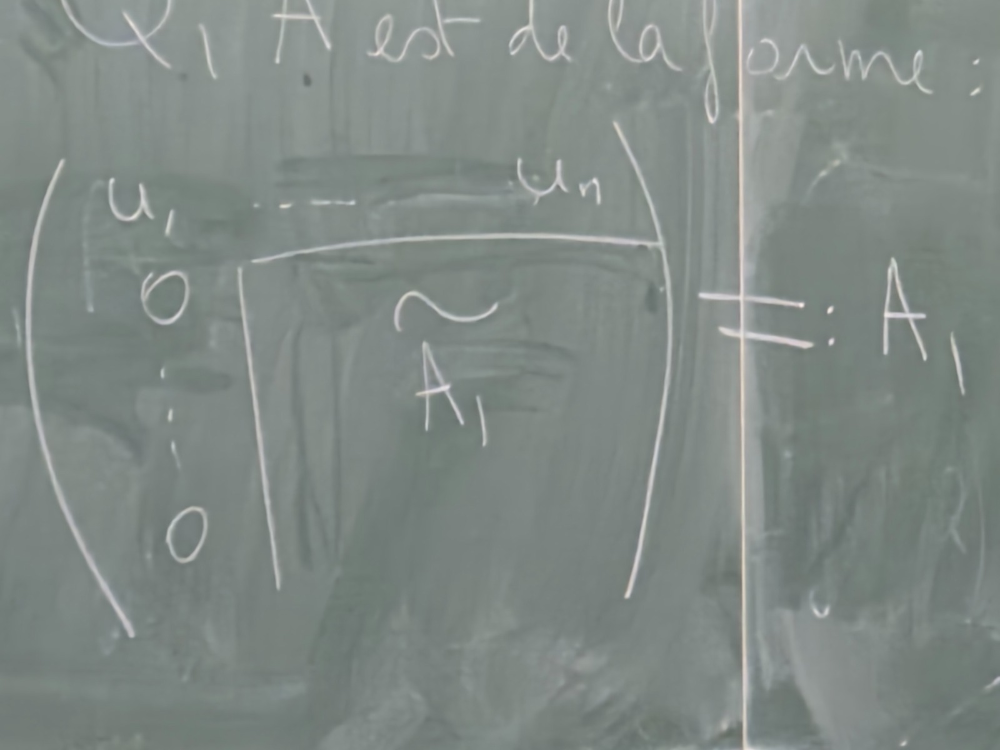
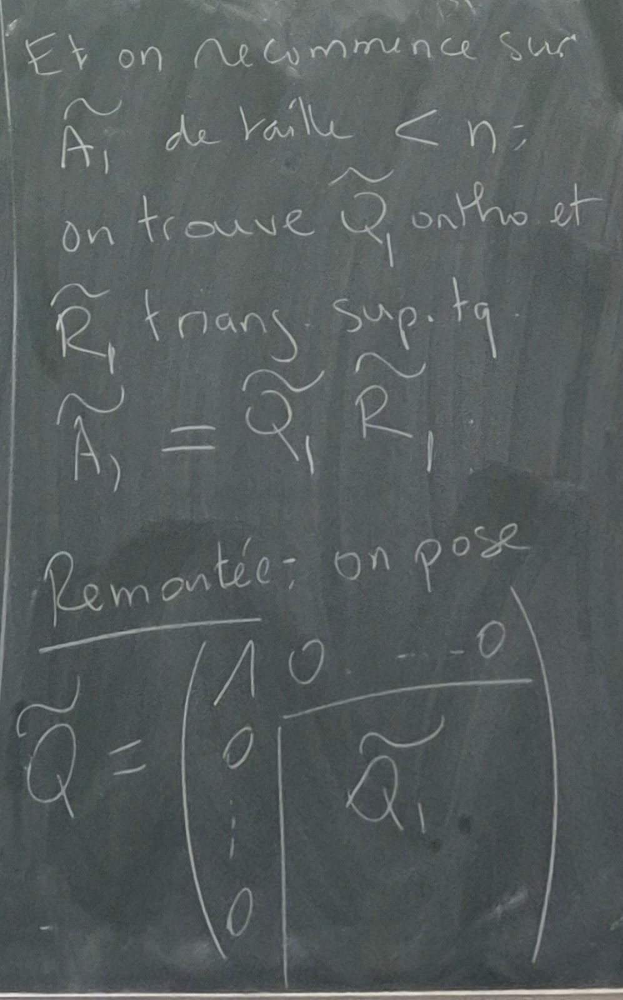
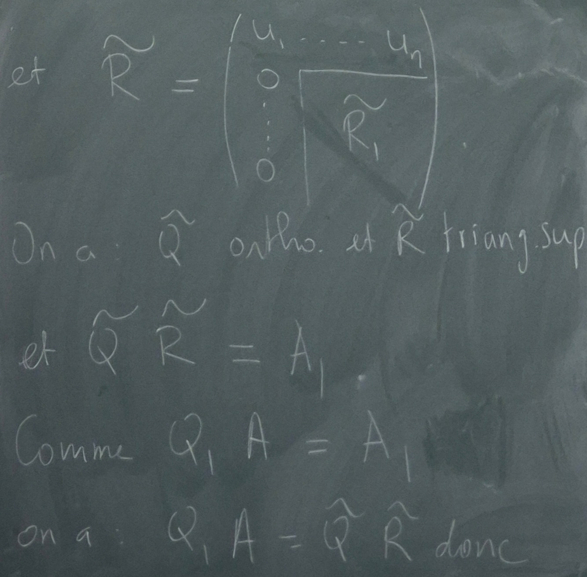
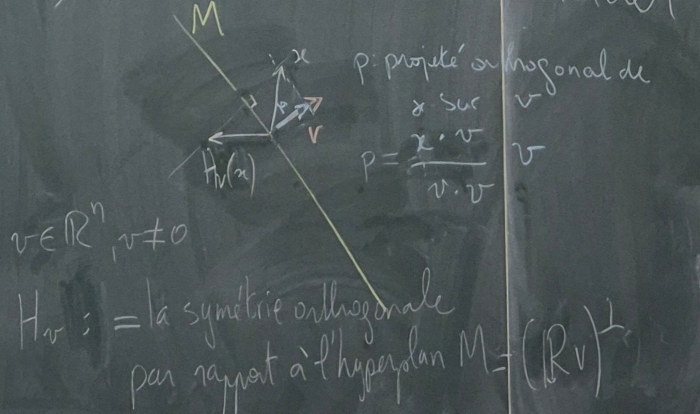
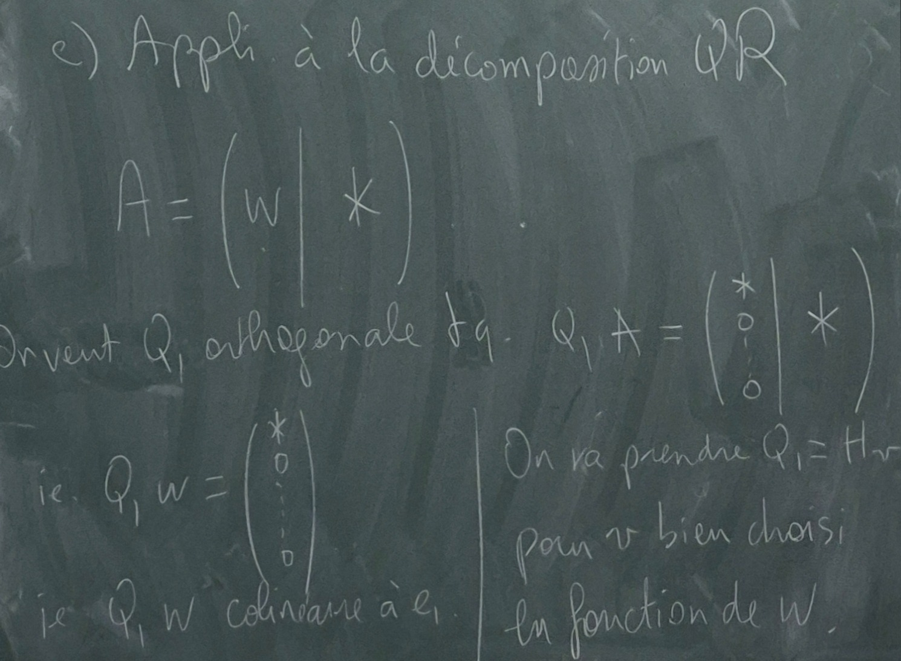
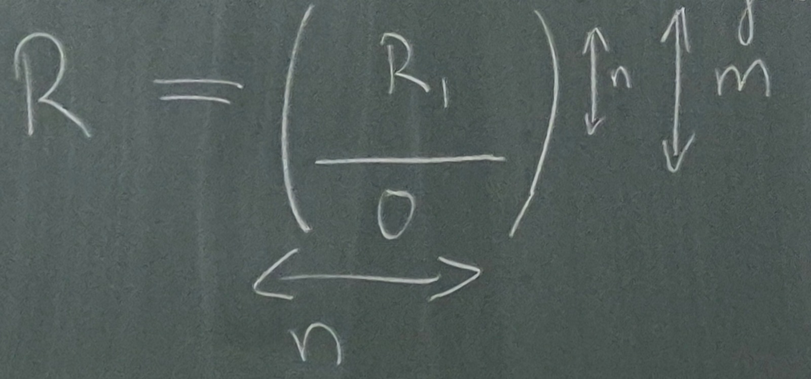
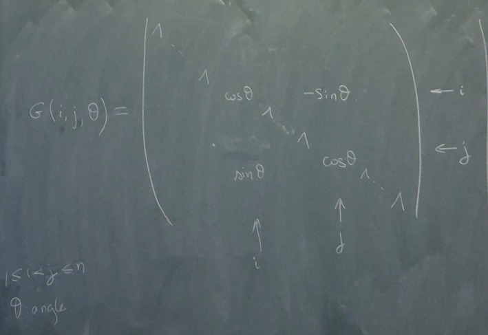

# Séance 2

## 1. Décomposition QR

**Idée :** décomposer une matrice A comme un produit :

$A = QR$ avec $Q$ ? et $R$ triangulaire

On va demander à $Q$

- d'être facile à inverser
- $Q$ soit toujours d'un conditionnement optimal (ou le plus + petit possible).

### 1.

Matrices orthogonales. On se place dans $R^n$ avec la norme Euclidienne $||.||_2$ et le produit scalaire.

**Définition :** On dit qu'une matrice $Q \in M_n (\R)$ est orthogonale si

Pour tout $x \in \R^n, ||Q_x|| = ||x||$

(On peut aussi dire que $Q$ est une isométrique)

**Propriétés :** Pour $Q \in M_n(\R)$ il y a équivalence entre :

- **a)** $Q$ est orthogonale
- **b)** Pour tout $x, y \in \R^n, (Qx)(Qy) = xy$
- **c)** $Q$ est inversible et $Q^{-1} = Q^t$

**De plus :**

- (E1) $Q$ orthogonal $<=> Q^t$ orthogonal
- (E2) $Q$ orthogonal $<=>$ les colonnes de $Q$ forment une base orthonormée de $\R^n$
- (E3) $Q$ orthogonal $<=> les lignes de $Q$ forment une base orthonormée de $\R^n$
- (E4) le produit de deux matrices orthogonales est orthogonal

**Propriétés :**

**a)** $=>$ **b)** : Soit $Q$ orthogonale.

Soit $x, y \in \R^n$

$(Qx)(Qy) = \frac{1}{2}(||Q(x+y)||^2 - ||Qx||^2 - ||Qy||^2)$

(Rappel : si $b$ est une forme bilinéaire, $q$ sa forme quadratique alors $b(x, y) = \frac{1}{2}(q(x,y) - q(x) - q(y))$

$$ = \frac{1}{2}(||x+y||^2 - ||x||^2 - ||y||^2)$$

$$= xy$$

**b)** $=>$ **c)**

Pour tout $x, y, (Qx)(Qy) = (Qy)^t(Qx) = y^t(Q^tQ)x = y^tx$

(Rappel : Si $A \in M_{mm}(\R)$, $e_i^t Ae_j = A_{ij}$, où ($e_1, ..., e_n$) est la base canonique de $\R^n$)

Donc, pour tut $i, j$ en prenant $y = e_1$ et $x = e_j$

$(Q^tQ)_{ij} = e^t_ie_j = 1$ (si $i = j$), $= 0$ (si $i \neq j$)

$\rightarrow Q^tQ = I_n$

**c)** $=>$ **a)**

On prend $Q \in M_n(\R)$ tel que $Q^t = Q^{-1}$

Soit $x \in \R^n$

$||Qx||^2 = (Qx)^tQx = x^t(Q^tQ)x = x^tI_nx = x^tx = ||x||^2 \rightarrow Q$ orthogonal

**($E_1$) :** $Q$ orthogonal

$<=> Q^{-1} = Q^t$

$<=> (Q^{-1})^t = (Q^t)^t$

$<=> (Q^t)^{-1} = (Q^t)^t$

$<=> (Q^t)^{-1} = (Q^t)^t$

$<=> Q^t$ irreversible d'inverse $(Q^t)^t = Q$

$<=> Q^t$ orthogonal

**(E2) :** $Q^tQ$ est la matrice de Gram des colonnes de $Q$ : c'est la matrice des produits scalaires entre les colonnes de $Q$. Colonnes de $Q$ forment une b.o.n.

$<=>$ matrice de Fram des colonnes de $Q = I_n$

$<=> Q^tQ = I_n$

$<=> Q$ est orthogonal

**(E3) :** Colonnes de $Q$ forment une b.o.n

$<=>Q$ est orthogonal

$<=>Q^t$ est orthogonal **(via E1)**

$<=>$ les colonnes de $Q^t$ forment une b.o.n

$<=>$ les lignes de $Q^t$ forment une b.o.n

**(E4) :** Soit $x \in \R^n, Q_1, Q_2$ orthogonal

$||Q_1Q_2x|| = ||Q_2x||$ car $Q_2$ orthogonal

$= ||x||$ car $Q_1$ orthogonal

donc $Q_1Q_2$ orthogonal

#### Condictionnement d'une matrice orthoginale

Soit $Q$ orthogonale

$R(Q) = ||Q||_2||Q^{-1}||_2$

$||Q||_2 = sup ||Qx||$ avec $||x|| \leq 1$

$=sup ||x|| = 1$

$||Q^{-1}||_2 = ||Q^t||_2 = 1$ car $Q^t$ est orthogonal

$$\rightarrow K(Q) = 1$$

**Remarque :** si $A$ inversible, pour tout $x$

$||x|| = ||A^{-1}Ax||$

$||x|| \leq ||A^{-1}||.||Ax||$

$||x|| \leq ||A^{-1}||.||A||.||x||$

$$\rightarrow ||A^{-1}||.||A|| \geq 1$$

Donc le conditionnement de toute matrice inversible est $\geq 1$

$\rightarrow$ les matrices orthogonales ont un conditionnement optimal.

### 2. Principe de la décomposition QR

Soit $A$ la matrice à décomposer.

On cherche $Q$ orthogonale et $R$ triangulaire supérieure telles que $A = QR$.

Par analogie avec la décomposition $LU$ on commence par chercher une matrice $Q_1$ orthogonal telle que : $Q_1A$ est de la forme :

Et on recommence sur $A_1$ de taille $< n$ : On trouve $Q_1$ orthogonale et $R$ triangulaire supérieur tel que $A_1 = Q_1R_1$

**Remontée :** On pose

iic photo

On $Q$ orthogonal et $R$ triangulaire supérieur et $QR = A_1$

Comme $Q_1A = A_1$

On a : $Q_1A = QR$

donc :

$A = Q_1^{-1}QR = (Q_1^tQ)R$

donc :

$$A = QR$$

Avec $Q = Q_1^tQ$, orthogonale comme produit de matrices orthogonales

$R = R$ triangulaire supérieur

$\rightarrow$ **Question :** Comment trouver $Q_1$ ?

### 3. Réflexion de Householder

Pour $x \in \R^n$

$H_v(x) = x - 2p$

$H_v(x) = x - 2 \frac{xv^T}{v^Tv}v$

Matrice de $H_v$

$$H_v = I_n - 2 \frac{vv^T}{v^Tv}$$

**Remarque :** En pratique, on ne forme jamais la matrice $H_v$, mais on peut calculer des produits entre les matruce et un vecteur avec $(*)$.

Pour calculer $H_vw = H_v(w)$

orthogonalité de $H_v$ ?

$H_vH_v = Id$ **(i)**

$\rightarrow H_v^{-1} = H_v$

Donc, pour montrer que $H_v$ est orthogonal (c'est à dire $H_v^{-1} = H_v^t$), il suffit de montrer que $H_v^t = H_v$. **(2)**

#### Preuve de **(i)**

$H_v = I_n - 2 \frac{vv^t}{v^tv}$

$H_v^2 = I_n^2 + 4 \frac{(vv^t)(vv^t)}{(v^tv)^2}$

$H_v^2 = -4 I_n \frac{vv^t}{(v^tv)}$

Car $I_n$ commute avec $vv^t$.

#### Preuve de **(2)**

$H_v^t = I_n^t - 2 \frac{(vv^t)^t}{v^tv}$

$H_v^t = I_n - 2 \frac{(v^t)^tv^t}{v^tv}$

$H_v^t = I_n - 2 \frac{(vv^t)}{v^tv}$

$H_v^t = H_v$

D'où **(2)**

## 2. Application à la décomposition QR

On va chercher $v$ comme $v = w + ae_1$ avec $a \in \R$ à déterminer pour que $H_vw$ soit colinéaire à $e_1$

$H_vw = W - 2 \frac{v^tvv}{v^tv}v$

On veut donc :

$$1 - 2 \frac{(w+ae_1)^tw}{(w+ae_1)^t(W+ae_1)} = 0$$

D'où :

$$a = \pm ||w||$$

On prend donc :

$$v = w + sgn(w_1)||w||$$

## 3. Application aux problèmes de moindres carrés

$A$ : matrice avec $m$ lignes et $n$ colonnes. Avec $m \geq n$

$b$ : vecteur de $\R^m$

On cherche $x \in \R^n$ qui minimise $||Ax-b||^2_2$

On avait vu qu'on peut trouver $x$ en résolvant :

$$A^TAx = A^Tb$$

Avec $A^TA$ symétrique mais $K(A^TA)$ grand.

On va voir une autre méthode pour trouver $x$, non affecie par ce problème de conditionnement.

On suppose $rg(A) = n$ (rang)

On peut faire une décomposition $QR$ de $A$ :

$A = QR$ avec $Q$ matrice orthogonale et $R$ triangulaire supérieure avec $m$ lignes et $n$ colonnes.

Avec $R_1$ triangulaire supérieure $nn$

Comment $rg(A) = n$ on a $R_1$ inversible ($rg(R_1) = n$ et $R_1$ est carré en $nn$)

$||Ax-b||^2_2 = ||QRx-b||^2_2$

$||Ax-b||^2_2 = ||Q^T(QRx-b)||^2_2$

$||Ax-b||^2_2 = ||Q^TQRx-Q^Tb||^2_2$

$||Ax-b||^2_2 = ||Rx-Q^Tb||^2_2$

$x = (\frac{x_1}{x_2})$ avec $x_1$ de taille $n$ et $x_1 + x_2$ de taille $m$

$Rx = (\frac{R_1x}{0})$

$Q^Tb = (\frac{b_1'}{b_2'})$

donc :

$$||Ax-b||^2_2 = ||Rx-b_1'||^2_2 + ||b_2'||^2_2$$

$\rightarrow$ le vecteur $x$ rendant $||Ax-b||^2_2$ minimal est donc la solution du système linéaire.

$$R_1x = b_1'$$

Ce syst-me est triangulaire donc peu coûteux à résoudre.

## 4. Matrices de Givens

Les réflexions de Householder ne sont pas les seules transformations orthogonales que l'on peut utiliser dans une décomposition $QR$

$\rightarrow$ Utiliser des rotations plutôt que des symétries ?

$G(i,i,\theta)$

Avec $1 \leq i < j \leq n$, $\theta$ un angle

$G(i,j,\theta)$ est la matrice de la rotation de centre $O_1$, d'angle $\theta$ dans $R_{e_i} + R_{e_j}$, laissant invariant $R_{e_n}$ pour $k \notin \{i,j\}$

$G(i,j,\theta)$ orthogonale :

$G(i,j,\theta)^{-1} = G(i,j,\theta) = G(i,j,\theta)^T$

(Par parité / imparité de $cos$ \ $sin$)

Dans la décomposition $QR$ on calcule $G(i,j,\theta)w$ où $w$ est la 1ère colonne de $A$.

Soit $w' = G(i,j,\theta)w$

Pour tout $k \notin \{i,j\}, w_k' = w_k$

$w_i' = cos(\theta)w_i - sin(\theta)w_j$

$w_j' = sin(\theta)w_i + cos(\theta)w_j$

On va chercher $\theta$ (en réalité, $cos$ et $sin$) pour que $w_j' = 0$, c'est à dire :

- $cos^2(\theta) + sin^2(\theta) = 1$
- $sin(\theta)w_i + cos(\theta)w_j = 0$

$cos(\theta) = \frac{w_i}{\sqrt{w^2_i + w^2_j}}$

$sin(\theta) = \frac{-w_j}{\sqrt{w^2_i + w^2_j}}$

(en pratique on ne calcule pas $\theta$, juste $cos$ et $sin$)

Householder élimine (presque) toute une colonne en une suele étape :

Avec Givens il faut, pour nettoyer toute colonne, faire plusieurs application :

$G(1,2,\theta_1)$

$G(1,3,\theta_2)$

$...$

$G(1,n,\theta_n)$

C'est $+$ coûteux.

$\rightarrow$ Deux avantages de Givens par rapport à Householder :

- **1)** si $A$ est creuse _(ex: si $A$ a beaucoup de coeffidients nuls)_, Householder peut faire apparaître des coeffidients $\neq$ 0 là où il y avait un coefficient $= 0$.
  Si il y a besoin de $-$ d'étapes de Givens dans un tel cas.
- **2)** Givens est $+$ parallèlisable que Householder car $G(i,j,\theta)$ et $G(k,l,\theta)$, pour $\{i, j\} \cap \{k, l\} = 0$ utilisent (et modifient) des coeffidients différents.
