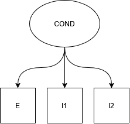
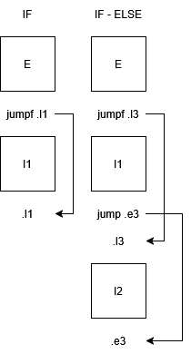
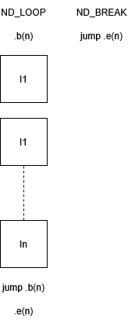
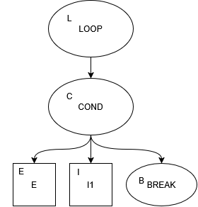
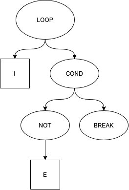
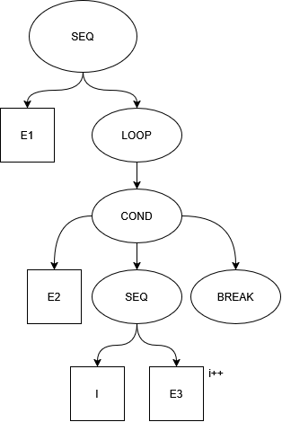

# Gencode

## Machine virtuelle

```bash
msm < toto.txt
```

(entrée standart)

La generation de code pourra être ainsi :

```
printf(".start")
<code source, boucles, etc...>
printf("halt") // Pour éteindre la machine
```

Voir chaque instruction :

```bash
msm -d < toto.txt
```

Voir la pile :

```bash
msm -d -d < toto.txt
```

Instruction pour debuggage

```
printf("dbg") // Affiche le sommet de la pile
```

## Pseudo code `gencode()`

```cpp
void gencode() {
    Node N = anasem();
    printf("resn %d\n", nbvar); // On réserve de l'espace pour les variables
    gennode(N);
}
```

```cpp
void gennode(Node N) {
    for (int i = 0; i < nb_si; i++) {
        if (SI[i].type == N.type) {
            // Préfixe
            if (!SI[i].prefix.empty()) {
                printf("%s\n", SI[i].prefix.c_str());
            }
            // Enfants
            for (int j = 0; j < N.nb_children; j++) {
                gennode(N.children[j]);
            }
            // Suffixe
            if (!SI[i].suffix.empty()) {
                printf("%s\n", SI[i].suffix.c_str());
            }
            return;
        }
    }

    switch (N.type) {
        case ND_SEQUENCE:
        case ND_BLOCK:
        for (int i = 0; i < N.nb_children; i++) {
            gennode(N.children[i]);
        }
        break;

        case ND_CONST: printf("push %d\n", N.value); break;
        case ND_REF: printf("get %d\n", N.index); break;

        case ND_ASSIGNEMENT:
            gennode(N.children[1]); // ND_CONST ou ND_REF
            printf("dup\n"); // On duplique la valeur à assigner pour la garder sur la pile
            printf("set %d\n", N.children[0].index); // On assigne la valeur à la variable
            break;

        // TODO: autre commande...
    }
}
```

_Exemple de tables pour gennode :_

```
struct SimpleInstruction {
    Node node;
    std::string prefix;
    std::string suffix;
}
```

```
SI = [
    {
        ND_ADD, "", "add"
    },
    {
        ND_MUL, "", "mul"
    },
    {
        ND_NEG, "push 0", "sub"
    },
    ...
]
```

Tableau des instructions

| Noeud       | Préfixe | Suffixe |
| ----------- | ------- | ------- |
| ND_ADD      |         | add     |
| ND_MUL      |         | mul     |
| ND_NEG      | push 0  | sub     |
| $...$       | $...$   | $...$   |
| ND_DROP     |         | drop    |
| ND_BLOCK    |         |         |
| ND_DEBUG    |         | dbg     |
| ND_SEQUENCE |         |         |

### Conditionnel



Executer `E`, en fonction du résultat executer `I1` **ou potentiellement** `I2`.



Le label correspond au **compteur**.

```
...
case ND_COND:
    int label = nb_label++;
    gennode(N.children[0]);
    printf('jumpf l%d', nb_label);
    gennode(N.children[1]);
...
```

### Boucles

Noeud `ND_LOOP` et `ND_BREAK`



```
int nb_break = 0; // variable globale

case ND_LOOP:
    int nb_b = nb_b++;
    // Sauvegarde locale
    int save = nb_break;
    nb_break = nb_b;

    printf(".b%d\n", nb_b);
    for (int i = 0; i < N.nb_children; i++) {
        Node E = N.children[i];
        gennode(E);
    }
    printf("jump b%d\n", nb_b);
    printf(".e%d\n", nb_b);
    // Restauration de la sauvegarde
    nb_break = save;

case ND_BREAK:
    printf("jump e%d\n", nb_break);
```

Arbre `while`



Arbre `do while`



Arbre `for`


